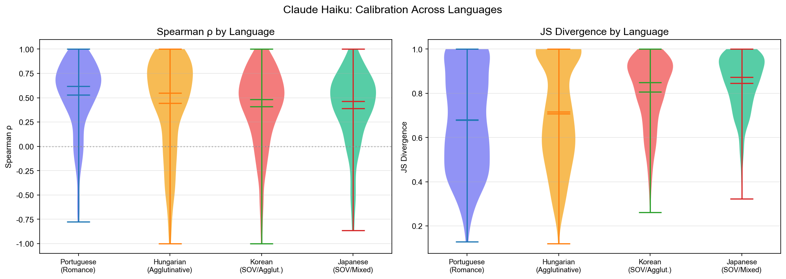

# llm-translation-calibration

Do LLMs put their probability on the translations that learners actually write?

This was my project for the KU Leuven Datathon 2026 (Duolingo data, February 2026). I worked on it alone.

## Question

The STAPLE 2020 data gives, for each English prompt, the full set of accepted translations with a weight for how often Duolingo learners produced each one. I used those weights as the reference distribution and asked how close an LLM's own ranking of translations comes to it.

## What the code does

1. `src/parse_staple.py` turns the STAPLE gold files into one JSON per language pair and split.
2. `src/llm_multi_translate.py` asks a model for 15 to 30 translations of each prompt in one call. Rank `i` gets weight `0.7^i`, then the weights are normalised.
3. `src/llm_local.py` does the same with Ollama models.
4. `src/metrics.py` compares the two distributions per prompt: Spearman correlation, Jensen-Shannon divergence, expected calibration error, and weighted recall at K (how much learner weight the model's top K translations cover).
5. `src/evaluate.py`, `src/compare_models.py`, `src/deep_analysis.py` aggregate and plot.

`llm_scoring.py` and `llm_sampling.py` are two earlier routes (score each gold translation, or sample 30 times at temperature 1). I dropped them because of cost and kept the files.

## Results

500 dev prompts per language pair. Numbers are from `results/summary_all.json` and `results/eval_haiku_en_pt_full.json`.

Claude Haiku 4.5, four language pairs:

| Pair | Spearman | JS divergence | ECE | WR@10 |
|---|---|---|---|---|
| en-pt | 0.53 | 0.68 | 0.044 | 0.296 |
| en-hu | 0.44 | 0.72 | 0.046 | 0.287 |
| en-ko | 0.41 | 0.81 | 0.062 | 0.112 |
| en-ja | 0.39 | 0.85 | 0.064 | 0.082 |

Three models on en-pt:

| Model | Spearman | JS divergence | ECE | WR@10 |
|---|---|---|---|---|
| Claude Haiku 4.5 | 0.53 | 0.68 | 0.044 | 0.296 |
| Qwen 2.5 7B | 0.43 | 0.94 | 0.094 | 0.061 |
| Llama 3.2 3B | 0.59 | 0.97 | 0.086 | 0.033 |



What I take from this:

- The model's top 10 translations cover about 30% of learner weight in Portuguese and Hungarian, and about 10% in Korean and Japanese.
- For most prompts, more than 20% of the model's probability sits on translations that are not in the accepted set at all. That happened in 376 of 500 Portuguese prompts for Haiku and in all 500 for Llama.
- The two small local models cover very little learner weight.

## Limits

- The probabilities are not the model's real probabilities. They come from the rank order and a fixed decay of 0.7, which I chose and did not tune.
- Matching is by exact string after normalisation. A correct translation with a different spelling counts as outside the set. This hurts Japanese and Korean most, so the language ranking is partly a matching effect.
- Spearman is computed only on translations that appear in both lists, and needs at least three. Llama has the highest Spearman and the lowest coverage, so that column alone is misleading.
- One run per model, dev split only, no confidence intervals.

## Running it

```
pip install -r requirements.txt
```

Download the STAPLE 2020 data from the [Duolingo Dataverse page](https://doi.org/10.7910/DVN/38OJR6) and unpack it as `2020 STAPLE Shared Task Data/staple-2020/` in the repo root. The data is not included here.

```
python src/parse_staple.py
python src/llm_multi_translate.py --lang en_pt --split dev --model claude-haiku --max_prompts 5
python src/evaluate.py --result results/multi_claude-haiku_en_pt_dev.json --lang en_pt
```

API keys are read from `ANTHROPIC_API_KEY` and `OPENAI_API_KEY`. The full Haiku runs cost between $0.88 and $1.27 per language pair.

Code comments are in Chinese.
